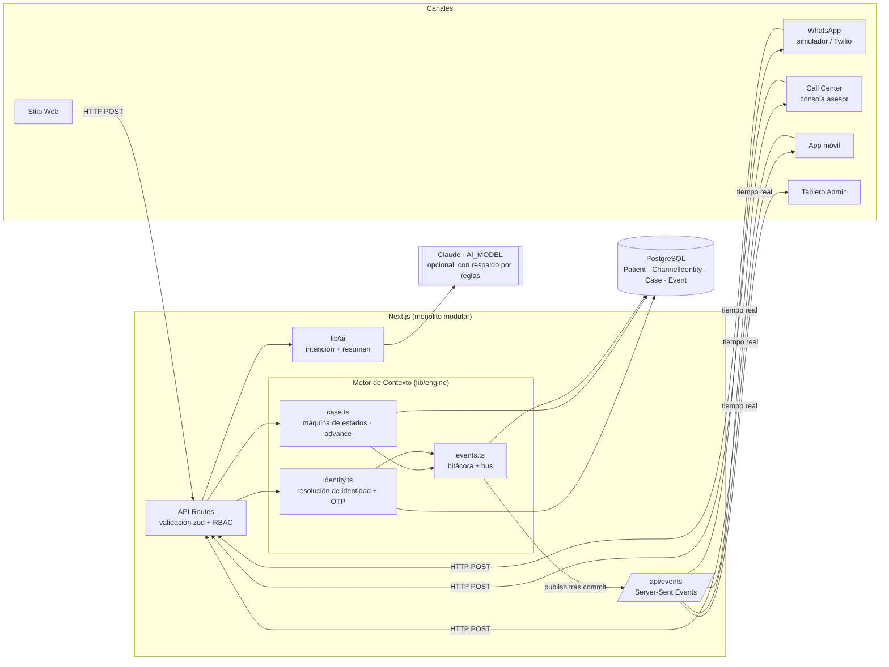

# Arquitectura de la solución

**Principio:** el estado del trámite vive en un solo lugar (el *Motor de Contexto*). Los canales son clientes delgados: leen el caso, piden avanzar y escuchan eventos. Por eso cambiar de canal no pierde nada.

## Decisiones

| Decisión | Por qué | Cómo escala en producción |
|---|---|---|
| Monolito modular (Next.js) | Un solo despliegue; módulos ya separados por carpeta | Extraer `lib/engine` como servicio |
| Bitácora `Event` append-only | Trazabilidad completa: qué, cuándo, dónde, quién | Particionar por fecha; exportar a data lake |
| Bus en memoria + SSE | Flujo servidor→cliente; reconexión automática con `Last-Event-ID` y replay desde la BD | Postgres LISTEN/NOTIFY, Redis o Kafka entre instancias |
| Bloqueo optimista (`Case.version`) | Dos canales editando a la vez → el segundo recibe 409, nunca se pisa información | Igual |
| Idempotencia (`Event.idempotencyKey`) | Reintentos de webhooks (Twilio) no avanzan dos veces | Igual |
| IA acotada con fallback | La demo nunca depende del LLM; al LLM no se le manda PII | Igual |

## Estrategia de identidad

Llave maestra: **teléfono E.164 verificado**. Cada canal tiene su `ChannelIdentity`; se liga al `Patient` cuando se verifica.

| Canal | Identificador | Verificación |
|---|---|---|
| Web | cookie anónima | OTP al teléfono → liga identidad y **mueve sus trámites anónimos** al paciente |
| WhatsApp | número remitente (posesión del teléfono) | + fecha de nacimiento (máx. 3 intentos / 10 min) |
| Call Center | búsqueda por teléfono/nombre | datos enmascarados hasta validar 2 datos u OTP |
| App | usuario | teléfono + OTP |

## Modelo de persistencia del contexto

- `Case.step` + `Case.data` (JSON) = **foto actual** del trámite: estudio, clínica, horario, folio. Se guarda en cada paso, así la información parcial nunca se pierde.
- `Event` = **película** del trámite: cada cambio, canal y actor, en orden global (`seq`).
- Retomar en cualquier canal = leer `Case` → `pendingStep(step)` dice qué falta preguntar.
