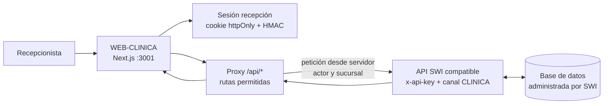
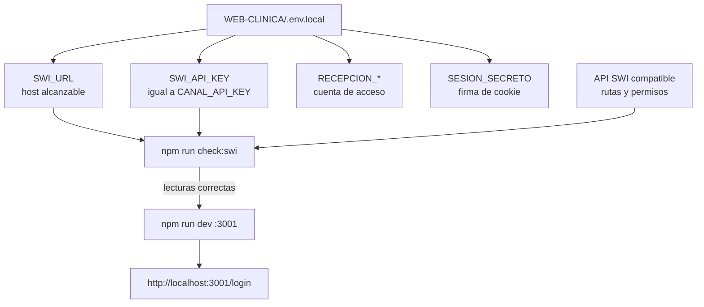

# Canal Clínica: recepción WEB-CLINICA

## 1. Propósito y alcance

El canal Clínica es la interfaz de recepción de una sucursal. Permite consultar la agenda, registrar o completar pacientes, marcar llegadas, agendar en mostrador, cobrar con una pasarela de prueba, entregar resultados y cancelar trámites.

La interfaz está en el proyecto independiente `WEB-CLINICA`, que se ejecuta en el puerto `3001`. No guarda datos clínicos en una base propia: consume un backend SWI usando una llave API desde el servidor.

> **Estado de integración:** el backend SWI compatible no está incluido en este workspace. La API del proyecto `SaludDigna` expone un contrato distinto; iniciar los dos frontends no basta para completar la conexión.

## 2. Arquitectura y flujo de una operación



### Pasos operativos

1. La recepcionista abre `/login` e inicia sesión con la cuenta local configurada.
2. Selecciona la sucursal que atenderá.
3. La interfaz solicita a SWI la agenda de esa sucursal, pacientes o contexto del trámite.
4. El proxy valida la sesión, limita la ruta a la lista permitida y agrega la llave API y el contexto de la acción.
5. SWI valida el canal `CLINICA`, la llave y los datos; lee o actualiza su base central.
6. La respuesta vuelve por el proxy a la interfaz. Los cambios se reflejan en el recorrido omnicanal si SWI publica correctamente los eventos al sistema compartido.

La cookie de recepción está firmada con HMAC y dura 12 horas. La llave SWI se conserva en el servidor; nunca debe llegar al navegador.

## 3. Funciones de recepción

### Agenda

- Muestra las citas del día para la sucursal elegida.
- Permite filtrar por estado de llegada y cancelación.
- Presenta el canal de origen y el estado de pago.
- Se actualiza periódicamente para detectar cambios hechos desde otros canales.

### Registro y ficha del paciente

- Busca por celular o CURP.
- Si no encuentra al paciente, permite registrarlo.
- Si hay un registro incompleto, permite completar sus datos manteniendo el teléfono como identificador de contacto.
- La ficha presenta citas y el recorrido de los canales, sujeto a la información que devuelva SWI.

### Atención del trámite

- **Check-in:** marca llegada y puede confirmar la cita si todavía estaba pendiente.
- **Agendar en mostrador:** elige estudio, sucursal, fecha y horario disponibles.
- **Continuar un trámite:** si existe un trámite abierto, lo continúa en vez de duplicarlo.
- **Cobro:** usa el proveedor de prueba configurado; no debe interpretarse como procesamiento de pagos real.
- **Resultados:** registra la entrega de resultados cuando esa ruta esté disponible en el backend.
- **Cancelación:** registra el motivo y el estado correspondiente.

## 4. Configuración crítica

El archivo de configuración local es `WEB-CLINICA/.env.local`. No se debe subir al repositorio ni compartir si contiene credenciales.

| Variable | Qué configurar | Importancia |
|---|---|---|
| `SWI_URL` | Origen del servidor SWI, por ejemplo `http://<IP-del-servidor>:3000` | Debe apuntar al equipo que ejecuta la API compatible, no necesariamente al servidor SaludDigna de este checkout |
| `SWI_API_KEY` | Llave asignada por el backend SWI | Debe coincidir con `CANAL_API_KEY` en SWI; se mantiene del lado servidor |
| `RECEPCION_USUARIO` | Usuario de recepción local | Identidad con la que se inicia sesión en la interfaz |
| `RECEPCION_PASSWORD` | Contraseña de recepción local | Cambiar el valor demo antes de cualquier uso no demostrativo |
| `RECEPCION_NOMBRE` | Nombre que aparecerá como actor | Ayuda a identificar quién realizó la acción |
| `SESION_SECRETO` | Secreto largo para firmar la cookie local | Sustituir el valor de ejemplo; no reutilizar una llave pública o de demo |

### Elegir correctamente `SWI_URL`

- Si el backend SWI y WEB-CLINICA están en la misma computadora, `http://localhost:3000` solo funciona si ese servicio implementa las rutas esperadas.
- Si SWI está en otra computadora, usa su IP privada o nombre DNS accesible: `http://<IP-del-SWI>:3000`.
- No uses `localhost` para apuntar a una Mac/servidor remoto: `localhost` siempre se refiere al propio equipo donde corre WEB-CLINICA.
- Comprueba que ambos equipos estén en una red que permita el tráfico y que el firewall acepte conexiones al puerto SWI.
- `SWI_URL` es el origen; el cliente de comprobación agrega `/api` cuando hace falta.

## 5. Contrato y prueba de conectividad

Desde `WEB-CLINICA`, ejecuta:

```powershell
npm run check:swi
```

La prueba es de solo lectura y no registra pacientes ni modifica trámites. Comprueba:

| Prueba | Solicitud | Resultado esperado |
|---|---|---:|
| 1 | `GET /api/estudios` | `200` |
| 2 | Búsqueda de paciente sin `x-api-key` | `401` |
| 3 | Búsqueda de paciente con llave | `200` |
| 4 | `GET /api/clinicas` con llave | `200` |
| 5 | Agenda de la primera clínica para la fecha actual | `200` |
| 6 | Contexto de un paciente de prueba | `200` |

La prueba 5 puede tardar; el script la aborta si excede su tiempo límite. Ante un error, revisa `SWI_URL`, conectividad, validez de la llave, rutas y registros de SWI.

### Rutas que debe proporcionar SWI

El script de comprobación valida al menos:

- `GET /api/estudios`
- `GET /api/pacientes/buscar?metodo=telefono&telefono=...`
- `GET /api/clinicas`
- `GET /api/clinicas/:id/agenda?fecha=YYYY-MM-DD`
- `GET /api/pacientes/:telefono/contexto`

El resto de las operaciones (registro, check-in, pagos, avance y cancelación) también requiere las rutas incluidas en la lista blanca del proxy de WEB-CLINICA. La definición de esa lista está en `WEB-CLINICA/app/api/[...ruta]/route.ts`.

## 6. Instalación y arranque local

Requisitos: Node.js 20 o posterior, npm y una API SWI compatible accesible.

Desde la carpeta contenedora del workspace:

```powershell
Set-Location .\WEB-CLINICA
Copy-Item .env.example .env.local
```

Edita `.env.local` con la dirección SWI, la llave entregada por el administrador del backend y las credenciales locales de recepción. Después instala, prueba y arranca:

```powershell
npm install
npm run check:swi
npm run dev
```

Abre `http://localhost:3001/login`, inicia sesión y selecciona la sucursal. Los pasos de la interfaz y credenciales de demostración están en [`WEB-CLINICA/README.md`](../../WEB-CLINICA/README.md).

La carpeta contenedora ofrece `npm run dev` para iniciar SaludDigna y WEB-CLINICA al mismo tiempo. Ese orquestador solo arranca los procesos; no instala ni reemplaza SWI, no crea su llave y no garantiza que el contrato de API sea compatible.

## 7. Diferencia entre SWI y la API de SaludDigna de este checkout

WEB-CLINICA solicita rutas como `/api/estudios`, `/api/clinicas` y `/api/pacientes/...`, autenticadas con `x-api-key`. La API de `SaludDigna` disponible aquí ofrece, entre otras, `/api/catalog`, `/api/cases` y `/api/patient/appointments`; no implementa el contrato SWI requerido.

Por lo tanto, configurar `SWI_URL=http://localhost:3000` hacia SaludDigna no crea compatibilidad. Para que la recepción funcione end-to-end hace falta levantar/proporcionar SWI compatible o desarrollar un adaptador que traduzca ambos contratos y verificarlo con pruebas.

## 8. Seguridad y uso adecuado

- Usa `.env.local` solo en desarrollo local; mantenlo fuera de Git.
- No copies `SWI_API_KEY` al frontend ni la compartas en capturas, tickets o documentación pública.
- Cambia las credenciales y el secreto de sesión demo antes de un despliegue.
- La cuenta de recepción y el canal de demo no constituyen una solución de autenticación clínica de producción.
- Los datos y pagos de demostración son ficticios. No conectes expedientes ni tarjetas reales sin los controles, acuerdos y validaciones correspondientes.

## 9. Diagrama resumido de configuración


