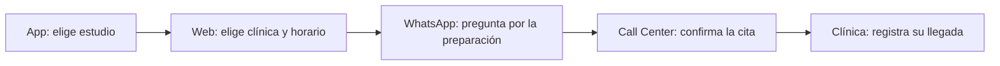

# Caso de uso: una cita en cinco canales

Valeria necesita hacerse una química sanguínea. Empieza el trámite en la App y lo termina en la clínica, usando los otros canales para elegir dónde ir y resolver sus dudas.

## Recorrido

1. **App:** Valeria ingresa su teléfono y elige el estudio.
2. **Web:** continúa el mismo trámite, selecciona una clínica y escoge un horario.
3. **WhatsApp:** pregunta si necesita ayunar. El bot le responde que debe ayunar 8 horas. Luego pide hablar con un asesor.
4. **Call Center:** un asesor verifica sus datos y confirma la cita.
5. **Clínica:** el día de la cita, Valeria llega a recepción y registra su llegada.

## Resultado esperado

En cada canal se encuentra el mismo trámite y Valeria no tiene que empezar de nuevo. El asesor puede revisar lo que pasó antes y la clínica recibe a la paciente para su cita.

## Importante sobre la Clínica

La App, Web, WhatsApp y Call Center pueden compartir el trámite en SaludDigna. La recepción de Clínica usa otro sistema y necesita una conexión especial para compartir los datos. Esa conexión no está incluida en el proyecto actual, así que el paso de Clínica no se sincroniza automáticamente.

Para configurar la recepción, consulta [la guía del canal Clínica](canal-clinica.md). Para instalar los canales, consulta [la guía de instalación](instalacion-canales.md).

## Diferencia con el ejemplo principal

El ejemplo principal empieza en Web. Este recorrido empieza en la App y termina en Clínica: **App → Web → WhatsApp → Call Center → Clínica**.
