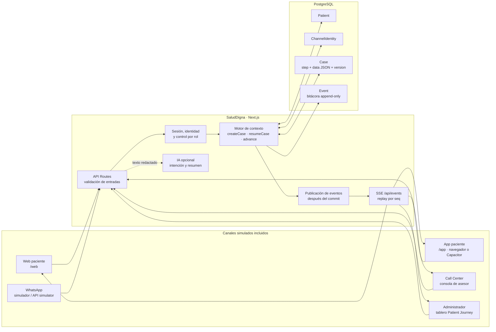
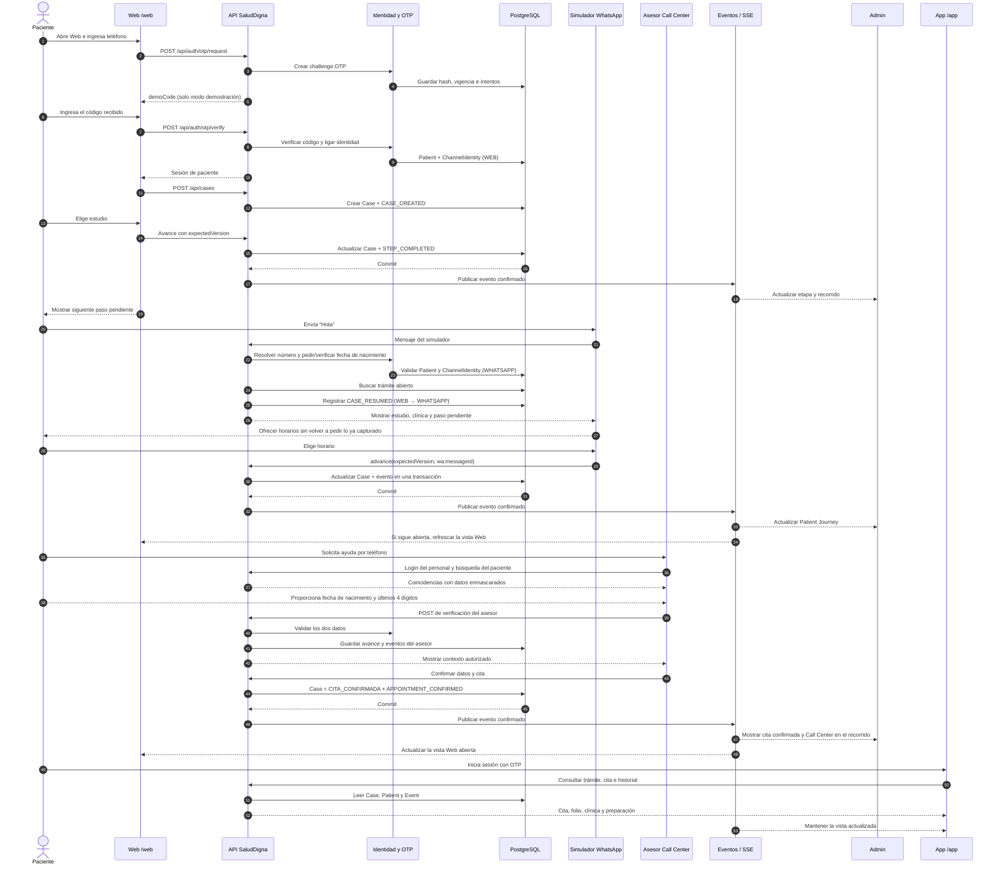
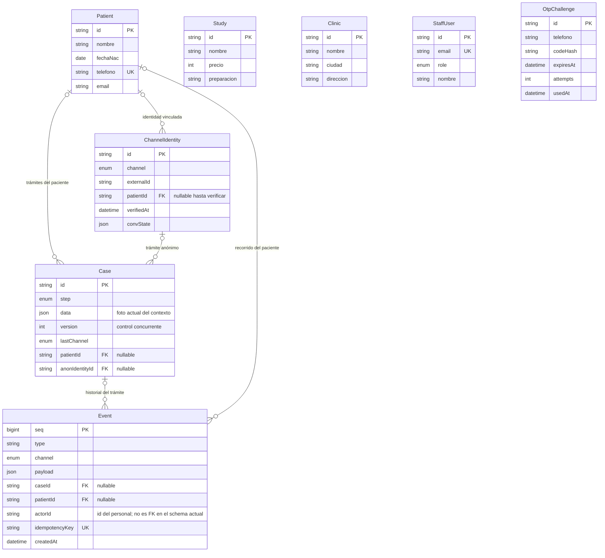
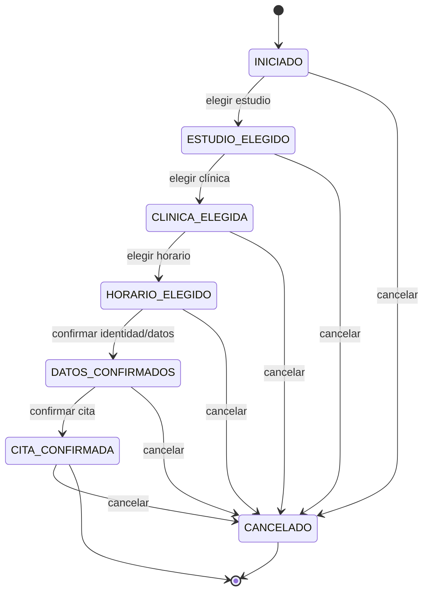
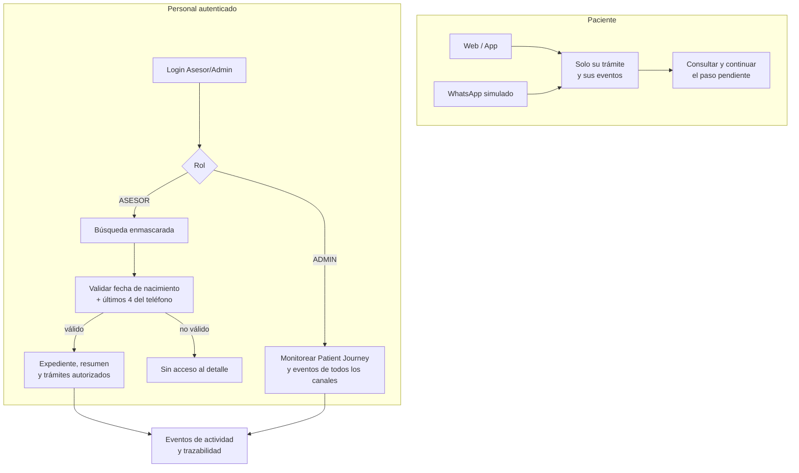

# Diagramas del proyecto conforme a los lineamientos

Estos diagramas responden directamente a la sección **“Diagramas y Arquitectura Técnica”** y a los requisitos de las Fases 1 y 2 de *ENH26-Estructura Entregable - SWI-SALUD DIGNA* (pp. 4–5). Describen la implementación del prototipo en este checkout; no representan como implementadas las integraciones reales que siguen pendientes.

## Correspondencia con lo solicitado

| Lineamiento | Diagrama |
|---|---|
| Conexión de canales simulados, motor de contexto y base de datos | 1. Arquitectura general |
| Resolución de identidad, persistencia del contexto y catálogo de eventos | 1 y 3 |
| Continuidad: iniciar en un canal y retomar en otro sin empezar de cero | 2. Secuencia omnicanal |
| Patient Journey por etapa, canal e historial, actualizado en tiempo real | 1, 2 y 4 |
| Vistas y permisos diferenciados para paciente, asesor y administrador | 5. Roles y visibilidad |
| Flujo de datos validado al cambiar de canal y su modelo de datos | 2 y 3 |

## 1. Arquitectura general: canales, motor de contexto y base de datos

**Lectura del diagrama**

- Los canales comparten una sola API y el mismo motor; las pantallas no mantienen una copia independiente del trámite.
- `Case` almacena el estado vigente (`step`, `data`) y el canal de la última actividad. `version` permite detectar escrituras concurrentes.
- Cada transición escribe el cambio y sus eventos en PostgreSQL dentro de una transacción. El evento se publica al bus solo después del commit.
- SSE distribuye actividad a las vistas autorizadas. `seq` permite reanudar la lectura después de una desconexión.
- La IA es opcional; no es fuente de verdad ni ejecuta transiciones del trámite.
- WhatsApp en este prototipo es un simulador. El webhook de Meta/Twilio no está incluido.
- WEB-CLINICA es un frontend separado y necesita un backend SWI compatible; no forma parte del flujo/API dibujado aquí.

## 2. Secuencia: un trámite que pasa por Web, WhatsApp, Call Center y App

**Validaciones que protegen la continuidad**

1. Web y App verifican el teléfono con OTP; WhatsApp simulado valida número y fecha de nacimiento; el asesor valida fecha de nacimiento y últimos cuatro dígitos.
2. `ChannelIdentity` relaciona el identificador de cada canal con el mismo `Patient`. Los casos anónimos, si existen, se ligan al verificarse.
3. Antes de avanzar, el motor valida transición y datos y compara `expectedVersion`. Una versión obsoleta produce conflicto `409`, no sobreescribe el avance del otro canal.
4. Los mensajes de WhatsApp usan su `messageId` como clave de idempotencia; un reintento no debe avanzar dos veces.
5. El tablero y las vistas autorizadas reciben eventos después de persistirse. Si SSE se reconecta, puede solicitar eventos posteriores al último `seq` recibido.

**Alcance de la demo:** el OTP se muestra como `demoCode`, no se envía por SMS. El remitente de WhatsApp proviene del simulador, no de una verificación de firma del proveedor.

## 3. Modelo de datos para identidad, contexto e historial

`Case.data` guarda la selección y los datos progresivos del trámite como JSON; el catálogo `Study`/`Clinic` vive en tablas del prototipo y sus selecciones se copian al contexto, sin FK entre esas tablas y `Case`. `Event` conserva la película ordenada del recorrido (`seq`), mientras `Case` mantiene la foto actual. `OtpChallenge` se asocia por teléfono, no por una relación FK a `Patient`. La relación `Event.actorId` con `StaffUser` es conceptual: el schema actual guarda ese identificador como texto, sin declarar una relación Prisma.

## 4. Estados del trámite y publicación al Patient Journey

Cada avance cambia `Case.step`/`Case.data`, incrementa `Case.version` y agrega `STEP_COMPLETED`, `APPOINTMENT_CONFIRMED` o `CASE_CANCELLED` según corresponda. Si cambia el canal, se agrega `CASE_RESUMED`. El tablero deriva la etapa actual del caso y el recorrido cronológico de sus eventos; el estado no se reconstruye desde la interfaz del navegador.

## 5. Vistas y permisos por rol

Las cookies de Web, App y personal son independientes (`sd_web`, `sd_app`, `sd_staff`). El rol `ADMIN` puede monitorear sin la validación del asesor; el rol `ASESOR` debe validar al paciente antes de acceder al detalle. El código de permisos está en `lib/auth/session.ts`.

## Referencias de implementación

- Arquitectura y decisiones: [arquitectura.md](arquitectura.md)
- Secuencia general del caso de Ana: [secuencia.md](secuencia.md)
- Modelo y máquina de estados: [modelo-datos.md](modelo-datos.md)
- Tipos de eventos: [eventos.md](eventos.md)
- Integraciones de producción pendientes: [integracion.md](integracion.md)
- Instalación y canales disponibles: [instalacion-canales.md](instalacion-canales.md)
