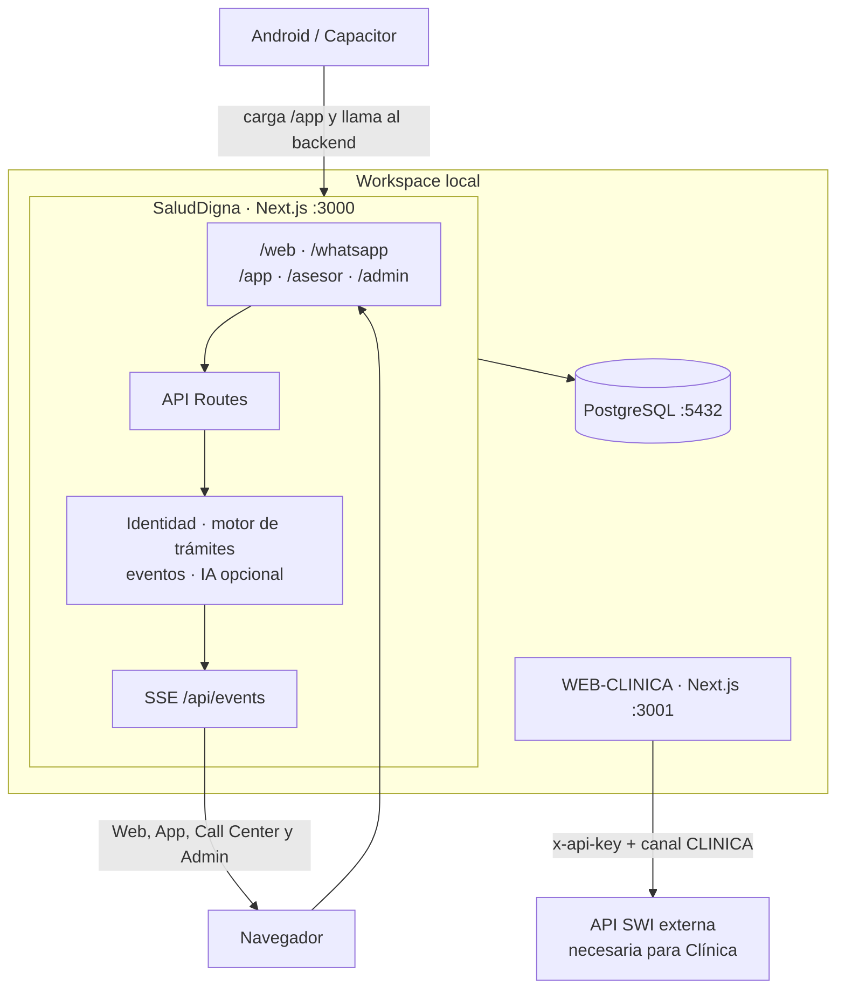
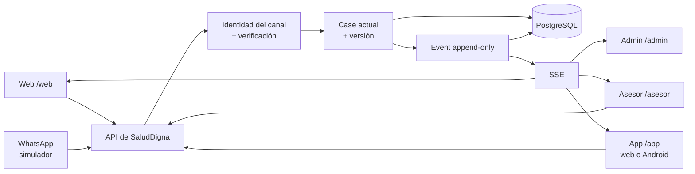
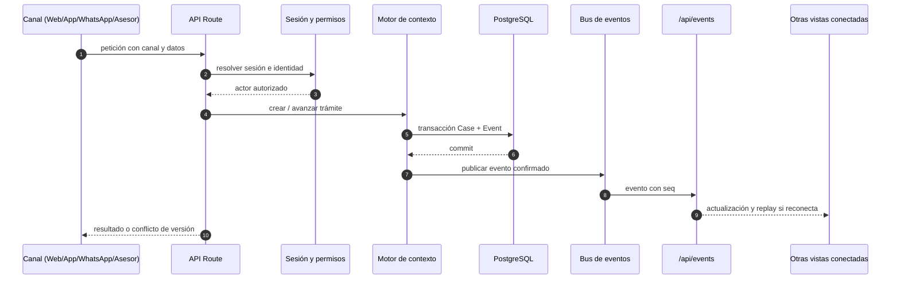
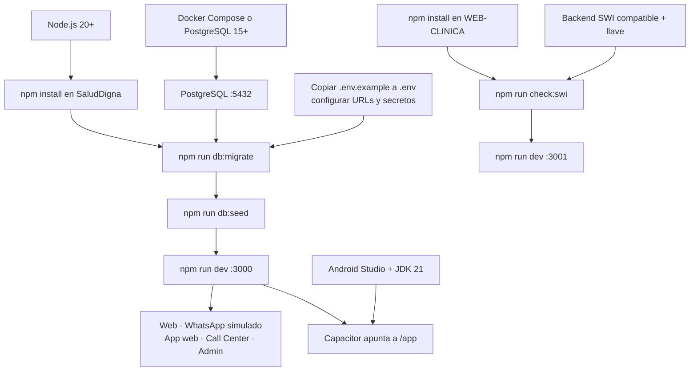

# Mapa de diagramas

Este índice reúne los diagramas del prototipo y separa el sistema que existe en el workspace de las integraciones futuras. Los diagramas Mermaid se pueden leer en GitHub y en editores compatibles con Mermaid.

## Diagrama de despliegue actual

**Límite importante:** WEB-CLINICA espera rutas de SWI que no están implementadas por la API de SaludDigna de este checkout. El diagrama muestra la dependencia requerida; no afirma que la integración entre ambas apps esté lista.

## Flujo compartido de los canales de paciente

El recorrido detallado de una persona es [secuencia.md](secuencia.md); el diseño futuro para proveedores reales está en [integracion.md](integracion.md).
La versión que vincula cada requisito del PDF con un diagrama específico está en [diagramas-lineamientos.md](diagramas-lineamientos.md).

## Recorrido de una petición con escritura y actualización en vivo

El catálogo de tipos de eventos y su significado está en [eventos.md](eventos.md). Los datos persistidos y la máquina de estados están en [modelo-datos.md](modelo-datos.md).

## Orden de instalación y dependencias

La secuencia de instalación completa con comandos por sistema operativo está en [instalacion-canales.md](instalacion-canales.md).

## Índice de diagramas por tema

| Tema | Archivo | Qué representa |
|---|---|---|
| Componentes y arquitectura lógica | [arquitectura.md](arquitectura.md) | Canales, Next.js, motor, persistencia, SSE, identidad y escalamiento |
| Secuencia entre canales | [secuencia.md](secuencia.md) | Web → WhatsApp → Call Center → App, y validación/resiliencia |
| Modelo relacional | [modelo-datos.md](modelo-datos.md) | Patient, ChannelIdentity, Case, Event, StaffUser y OTP |
| Estados del trámite | [modelo-datos.md](modelo-datos.md) | Transiciones, correcciones y cancelación |
| Integración futura | [integracion.md](integracion.md) | Adaptadores de WhatsApp, Web/App, Call Center, Clínica y sistemas fuente |
| Diagramas según lineamientos | [diagramas-lineamientos.md](diagramas-lineamientos.md) | Arquitectura, secuencia, modelo, Journey y roles alineados con el entregable |
| Preparación e instalación | [instalacion-canales.md](instalacion-canales.md) | Topología actual, dependencias, canales y pasos de arranque |
| Ejecución Android | [android.md](android.md) | Backend, emulador, teléfono físico y URL de despliegue |
