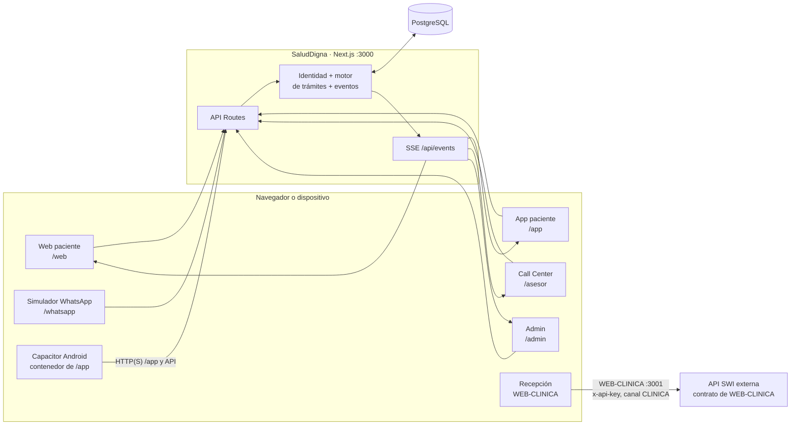

# Instalación y operación de los canales

Esta guía describe qué se instala realmente en este workspace, cómo preparar cada canal y cuáles dependen de servicios externos. La aplicación principal concentra los canales de paciente y personal; no se instala un servidor distinto para cada ruta web.

## Alcance del workspace

En la carpeta de trabajo hay dos aplicaciones:

| Proyecto | Función | Puerto de desarrollo |
|---|---|---:|
| `SaludDigna` | API, motor de trámites, PostgreSQL/Prisma, Web, simulador de WhatsApp, App web, Call Center y Admin | 3000 |
| `WEB-CLINICA` | Interfaz independiente de recepción; consume una API SWI externa mediante `x-api-key` | 3001 |

Las carpetas `SWI-Salud Digna`, `WhatsSimilado` y `WEB-SALUDDIGNA` mencionadas en documentación histórica no están incluidas en este workspace. Por eso:

- WhatsApp funciona aquí como **simulador web**; no hay webhook oficial de Meta/Twilio configurado.
- La App de paciente funciona como página `/app`; Android es un contenedor Capacitor que carga esa misma página.
- WEB-CLINICA necesita un backend SWI compatible. SaludDigna, tal como está aquí, no ofrece todas las rutas que WEB-CLINICA consulta. La presencia de ambos frontends no equivale a una integración funcional entre ellos.

## Topología actual



La descripción conceptual del motor está en [arquitectura.md](arquitectura.md); el recorrido de un trámite entre canales, en [secuencia.md](secuencia.md); y el esquema y estados, en [modelo-datos.md](modelo-datos.md).

## Requisitos

- Node.js 20 o posterior y npm.
- Docker Desktop con Docker Compose, o PostgreSQL 15+ instalado por separado.
- Navegador moderno.
- Solo para generar/ejecutar la app Android: Android Studio, Android SDK y JDK 21.
- Para recepción de clínica: acceso de red y credenciales para una API SWI que implemente el contrato señalado en la sección [Recepción de clínica](#recepcion-de-clinica-web-clinica).

Confirma las herramientas:

```powershell
node --version
npm --version
docker --version
docker compose version
```

## Instalar y arrancar SaludDigna

Los siguientes comandos se ejecutan desde la raíz de `SaludDigna`, no desde la carpeta contenedora del workspace.

### 1. Crear la configuración local

PowerShell:

```powershell
Set-Location .\SaludDigna
Copy-Item .env.example .env
```

macOS/Linux:

```bash
cd SaludDigna
cp .env.example .env
```

Edita `.env`. Como mínimo, revisa:

| Variable | Requisito |
|---|---|
| `DATABASE_URL` | Dirección de PostgreSQL de desarrollo; la plantilla apunta al servicio local de Compose |
| `TEST_DATABASE_URL` | Base separada para Vitest; no la apuntes a la base de desarrollo |
| `OTP_SECRET` | Cambia el valor de ejemplo por un secreto local aleatorio |
| `SESSION_SECRET` | Cambia el valor de ejemplo; el código requiere al menos 16 caracteres |
| `WHATSAPP_SIMULATOR` | `1` para la demo local del simulador |
| `ANTHROPIC_API_KEY` | Opcional; sin esta variable la aplicación usa reglas |
| `AI_DISABLED` | Opcional; `1` apaga la IA incluso si hay llave |

Puedes generar valores aleatorios con Node.js:

```powershell
node -e "console.log(require('node:crypto').randomBytes(32).toString('hex'))"
```

Genera un valor distinto para cada secreto. No compartas ni subas `.env` al repositorio.

### 2. Iniciar PostgreSQL e instalar dependencias

```powershell
docker compose up -d
docker compose ps
npm install
```

Compose levanta PostgreSQL en el puerto `5432` y crea `omnicanal_test` al inicializar un volumen nuevo. `npm install` ejecuta el `postinstall` de Prisma para generar el cliente.

Si no utilizas Docker, crea manualmente `omnicanal` y `omnicanal_test`, configura las dos URLs en `.env` y confirma que el usuario tenga permisos para crear tablas y ejecutar migraciones.

### 3. Migrar, cargar datos demo e iniciar

```powershell
npm run db:migrate
npm run db:seed
npm run dev
```

Abre `http://localhost:3000`. Las rutas de canales son:

| Canal | Página | Notas |
|---|---|---|
| Web de paciente | `http://localhost:3000/web` | Solicita y verifica el OTP de demo antes de ligar el trámite al paciente |
| WhatsApp simulado | `http://localhost:3000/whatsapp` | Escribe `Hola`; el simulador utiliza el número de prueba y fecha de nacimiento |
| Call Center | `http://localhost:3000/asesor/login` | El asesor busca pacientes y valida identidad antes de ver el expediente |
| Administrador | `http://localhost:3000/admin` | Tablero de actividad en vivo; usa el usuario Admin de demo |
| App paciente (web) | `http://localhost:3000/app` | La misma experiencia también se usa dentro de Capacitor |

Credenciales demo, datos ficticios y guion paso a paso: [README.md](../README.md) y [demo.md](demo.md). Mantén Admin en una sesión de navegador separada de Asesor si necesitas tener ambas sesiones abiertas.

### 4. Comprobar la instalación

En otra terminal, desde `SaludDigna`:

```powershell
npm test
npm run build
```

Las pruebas usan `TEST_DATABASE_URL`; el proceso sincroniza el esquema de prueba. Asegúrate de que esa URL apunte a una base descartable separada. Si la compilación o las pruebas necesitan variables, configura el entorno según `.env.example`.

## Instalación por canal

### Web del paciente

No tiene instalación ni base de datos propia: es una ruta de SaludDigna. Completa los pasos de la sección anterior y abre `/web`. El estado del trámite se guarda en PostgreSQL, no solo en el navegador; el mismo caso puede continuar en WhatsApp, App o Call Center.

### WhatsApp

**Demo local:**

1. Confirma `WHATSAPP_SIMULATOR=1` en `SaludDigna/.env`.
2. Inicia SaludDigna y PostgreSQL.
3. Abre `http://localhost:3000/whatsapp`, deja el número de Ana y envía `Hola`.
4. Verifica identidad con la fecha de nacimiento del paciente de demo. El simulador presenta el código/demo localmente; no envía SMS.

El endpoint disponible es `POST /api/whatsapp/simulator`; la lógica compartida está en `lib/channels/whatsapp.ts`. Cambiar `WHATSAPP_SIMULATOR` a `0` **no instala ni habilita WhatsApp Business**: el webhook de Meta/Twilio, la verificación de firma, las plantillas aprobadas, el opt-in y el envío de respuestas siguen pendientes. Consulta el diseño futuro en [integracion.md](integracion.md).

### Call Center y Admin

Ambos están dentro de SaludDigna; no hay un servidor de telefonía/CTI incluido.

1. Ejecuta las migraciones y `npm run db:seed`.
2. Abre `http://localhost:3000/asesor/login` para entrar como Asesor.
3. Abre `http://localhost:3000/admin` para el tablero Admin.
4. En la demo, usa perfiles de navegador distintos si se necesitan ambos roles al mismo tiempo: comparten la cookie del personal.

El asesor ve datos enmascarados antes de verificar identidad. La integración con telefonía, screen-pop y SSO corporativo está descrita como trabajo de integración futuro en [integracion.md](integracion.md).

### App del paciente en Android

La ruta `/app` funciona en el navegador sin Android Studio. Para usarla en un emulador o teléfono:

1. Instala Android Studio, Android SDK y JDK 21.
2. Inicia PostgreSQL y el backend con `npm run dev:mobile` desde `SaludDigna`.
3. Antes de sincronizar Capacitor, configura la URL accesible desde el dispositivo.
4. Ejecuta `npm run cap:sync` y `npm run cap:open`.
5. En Android Studio, sincroniza Gradle, selecciona el módulo `app` y ejecuta el emulador.

Emulador:

```powershell
$env:CAPACITOR_SERVER_URL = "http://10.0.2.2:3000/app"
npm run cap:sync
npm run cap:open
```

Dispositivo físico: usa `ipconfig` para encontrar la IPv4 de la PC, conecta ambos equipos a la misma Wi-Fi y configura `CAPACITOR_SERVER_URL` con `http://<IPv4-de-la-PC>:3000/app`. Permite Node.js en el firewall privado si Windows lo solicita. Para distribución, usa HTTPS; no publiques una compilación que apunte al emulador o a un servidor de desarrollo. Detalles: [android.md](android.md).

### Recepción de clínica (WEB-CLINICA)

WEB-CLINICA es una app separada que escucha en `3001` y no tiene una base de datos propia. En una terminal:

```powershell
Set-Location ..\WEB-CLINICA
Copy-Item .env.example .env.local
```

Edita `.env.local`:

- `SWI_URL`: origen del servidor SWI, por ejemplo `http://localhost:3000` solo si ese servicio implementa el contrato requerido; para un servidor remoto usa su IP/nombre accesible.
- `SWI_API_KEY`: llave entregada por el responsable del backend SWI; se mantiene en el servidor y no debe exponerse en el navegador.
- `RECEPCION_USUARIO`, `RECEPCION_PASSWORD`, `RECEPCION_NOMBRE`, `SESION_SECRETO`: cuenta demo y firma de sesión local; reemplaza los valores de ejemplo fuera de una demo.

Luego:

```powershell
npm install
npm run check:swi
npm run dev
```

Abre `http://localhost:3001/login`. `check:swi` realiza solicitudes GET de lectura; comprueba el catálogo y las rutas de búsqueda de paciente, clínicas, agenda y contexto. La prueba 2 debe devolver `401` sin llave; las pruebas 3–6 deben devolver `200` con llave y datos compatibles.

**Limitación comprobada:** el API de SaludDigna en este checkout incluye `/api/catalog`, `/api/cases`, `/api/patient/appointments` y `/api/staff/...`; no incluye las rutas SWI que WEB-CLINICA espera (`/api/estudios`, `/api/clinicas`, `/api/pacientes/...`, entre otras). Por lo tanto, `SWI_URL=http://localhost:3000` no basta para integrar Clínica con el backend de este proyecto. Para usar sus operaciones, solicita/levanta el backend SWI compatible y configura su dirección y llave. No confundas “la página carga” con “la API de Clínica está conectada”.

## Arrancar los dos proyectos desde la carpeta contenedora

El `package.json` de la carpeta contenedora ofrece scripts para SaludDigna y WEB-CLINICA; no instala las dependencias de ambos automáticamente. Primero instala cada proyecto por separado y prepara sus archivos de entorno:

```powershell
npm --prefix SaludDigna install
npm --prefix WEB-CLINICA install
```

Prepara también `SaludDigna/.env`, PostgreSQL, migraciones y seed, y `WEB-CLINICA/.env.local` con un SWI compatible. Desde la carpeta contenedora:

```powershell
npm run dev
```

El orquestador inicia SaludDigna en `3000` y WEB-CLINICA en `3001`; `Ctrl+C` detiene ambos. También existen `npm run dev:salud` y `npm run dev:clinica` para iniciar cada uno por separado. El orquestador no crea la base ni proporciona un servidor SWI externo.

## Solución de problemas

| Síntoma | Comprobación |
|---|---|
| Next.js no puede conectar a PostgreSQL | `docker compose ps`, `DATABASE_URL`, puerto `5432` y logs del contenedor |
| Error de tabla/esquema al arrancar | Ejecuta `npm run db:migrate`; para datos demo ejecuta `npm run db:seed` |
| OTP/sesión falla al firmar | Revisa que `OTP_SECRET` y `SESSION_SECRET` existan y que `SESSION_SECRET` tenga al menos 16 caracteres |
| WhatsApp no envía SMS | Es esperado: el código se simula; no hay proveedor SMS conectado |
| WEB-CLINICA carga pero agenda/búsqueda falla | Ejecuta `npm run check:swi`; comprueba SWI_URL, llave, conectividad y que la API implemente sus rutas |
| Android muestra pantalla sin conexión | Confirma URL de `CAPACITOR_SERVER_URL`, que Next.js escuche en red y que el teléfono/emulador alcance el puerto 3000 |
| Puerto ya ocupado | Detén solo el proceso de desarrollo que corresponda o usa la instancia activa; no inicies otro servidor en el mismo puerto |

## Producción y privacidad

Este repositorio es un prototipo de demostración: sus credenciales, datos seed, OTP visible en demo, HTTP local y simuladores no son una configuración de producción. Antes de un despliegue real se necesitan, como mínimo, secretos nuevos y gestionados fuera del repositorio, HTTPS, autenticación e integración de identidad aprobadas, rate limiting, proveedor de mensajería real, controles de privacidad/consentimiento, backups y monitoreo. La propuesta de endurecimiento está en [integracion.md](integracion.md).
