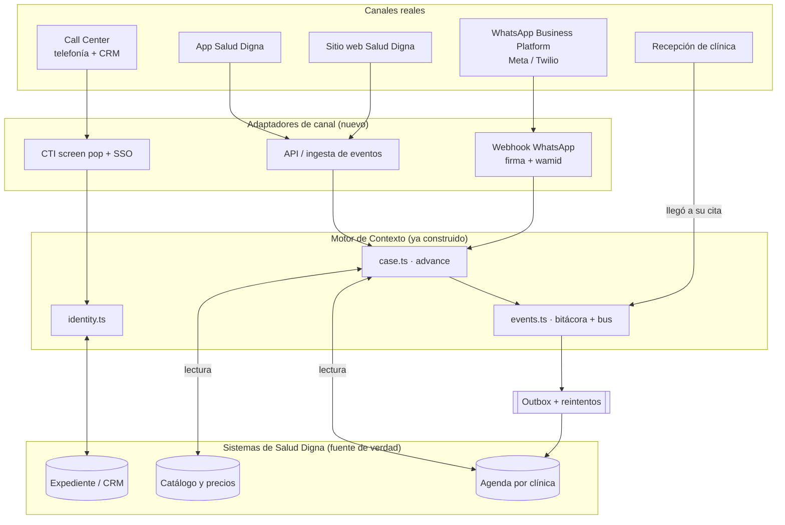

# Integración con los canales reales de Salud Digna

**Idea central:** el Motor de Contexto (identidad, `advance()`, bitácora de eventos y tiempo real) **no cambia**. Lo que se reemplaza son las puntas: los adaptadores de cada canal. Los canales simulados de este prototipo ya llaman al mismo motor que llamarían los reales; conectar un canal real significa cambiar su adaptador, no reescribir el sistema.

## Canal por canal

### WhatsApp
Hoy: `/api/whatsapp/simulator` → `handleInboundMessage()` en `lib/channels/whatsapp.ts`.

En producción, con la WhatsApp Business Platform de Meta (directo o vía Twilio/otro BSP):

1. **Webhook entrante** (`/api/whatsapp/webhook`): valida la firma (`X-Hub-Signature-256` de Meta o `X-Twilio-Signature`) y llama al **mismo** `handleInboundMessage({ from, text, messageId })`.
2. **Idempotencia:** el `wamid` de Meta es el `messageId`. El motor ya guarda `wa:in:<id>` como llave única, así que los reintentos del webhook no duplican pasos.
3. **Respuestas salientes:** las `replies` que regresa el handler se envían por la API de Meta. Las listas numeradas se convierten en **botones y listas interactivas** nativas.
4. **Ventana de 24 h:** fuera de ella solo se puede escribir con **plantillas aprobadas por Meta** y con opt-in del paciente (necesario para recuperar trámites pausados).
5. **Interruptor:** `WHATSAPP_SIMULATOR=0` apaga el simulador. El remitente lo garantiza Meta, por lo que desaparece el `shortcut:` del simulador que confía en el número escrito.

### Sitio web y app
Dos caminos, según cuánto quiera tocar Salud Digna sus sistemas:

| Opción | Cómo | Cuándo |
|---|---|---|
| **A. Usar nuestra API** | El flujo de agendado llama a `POST /api/cases` y `POST /api/cases/[id]` | Flujo nuevo o rediseño |
| **B. Enviar eventos** | Su flujo actual nos manda "cotizó", "eligió clínica", "abandonó"; el adaptador los traduce a `advance()` | Integración sin rehacer su web |

En la **app**, el login por OTP de la demo se reemplaza por **su autenticación**: el usuario de su app se liga a nuestra `ChannelIdentity` (canal `APP`, `externalId` = su id de usuario).

### Call Center
- **Screen pop por CTI:** al entrar la llamada, la telefonía (Genesys, Five9, Avaya, Salesforce Service Cloud…) manda el número; la consola abre la búsqueda por teléfono automáticamente.
- La consola `/asesor` se **incrusta** en su escritorio de agente (iframe o widget).
- **SSO corporativo** (SAML/OIDC) en lugar de `StaffUser` con contraseña; el rol ASESOR/ADMIN viene de sus grupos.
- La validación de 2 datos (`verifyByStaff`) y la auditoría `ADVISOR_OPENED_CASE` se mantienen igual.

### Clínica
El check-in en recepción entra como un evento más ("llegó a su cita"), y así el recorrido se cierra en el tablero.

## Sistemas de Salud Digna como fuente de verdad

El prototipo tiene su propio catálogo, horarios fijos y folios generados. En producción **nosotros orquestamos; los datos maestros son de Salud Digna**:

| Dato | Hoy (prototipo) | Producción |
|---|---|---|
| Catálogo y precios | Tablas `Study` / `Clinic` del seed | Lectura de su catálogo (caché corta) |
| Disponibilidad | 8, 10 y 12 h fijos (`lib/format.ts`) | Su agenda real por clínica |
| Confirmación y folio | `SD-XXXXXXXX` generado | Se crea la cita en su agenda; el folio lo da su sistema |
| Paciente | Teléfono E.164 como llave maestra | Ligado a su número de expediente / CURP |

**Casos reales a resolver:** teléfono compartido por la familia (la mamá agenda para sus hijos) → el bot pregunta "¿para quién es la cita?" y el trámite se liga al paciente correcto, no solo al teléfono.

**Entrega confiable (patrón outbox):** `advance()` ya guarda el evento en la misma transacción que el cambio de estado. Un proceso aparte lee los eventos pendientes de enviar (p. ej. `APPOINTMENT_CONFIRMED`) y los manda a su agenda con reintentos. Si su sistema está caído, no se pierde nada.

## Endurecimiento para producción

Los atajos están marcados con `shortcut:` en el código:

| Atajo actual | Dónde | Producción |
|---|---|---|
| Bus de eventos en memoria | `lib/engine/events.ts` | Postgres LISTEN/NOTIFY, Redis o Kafka (varias instancias) |
| OTP regresado al cliente (`demoCode`) | `lib/engine/identity.ts`, `app/api/auth/otp/request` | Envío por SMS/WhatsApp, nunca en la respuesta |
| Login del personal sin límite de intentos | `app/api/auth/staff/login` | SSO + rate limit |
| Simulador confía en el número | `app/api/whatsapp/simulator` | Webhook con firma verificada |
| Caché del resumen IA en memoria | `lib/ai/summary.ts` | Redis o BD |
| Tablero agrega en memoria | `lib/engine/overview.ts` | Vistas materializadas / consultas agregadas |
| Horarios fijos | `lib/format.ts` | Agenda real |

Además: secretos en un gestor (no en `.env`), TLS y cifrado en reposo, **aviso de privacidad y consentimiento conforme a la LFPDPPP** (datos de salud = datos sensibles), retención de la bitácora y monitoreo/alertas.

## Implantación por fases

1. **WhatsApp real** + catálogo y agenda de Salud Digna en modo lectura.
2. **Call Center** con CTI y SSO.
3. **Web y app** enviando eventos (opción B) o usando la API (opción A).
4. **Recuperación proactiva:** plantilla de WhatsApp a quien dejó un trámite pausado.
