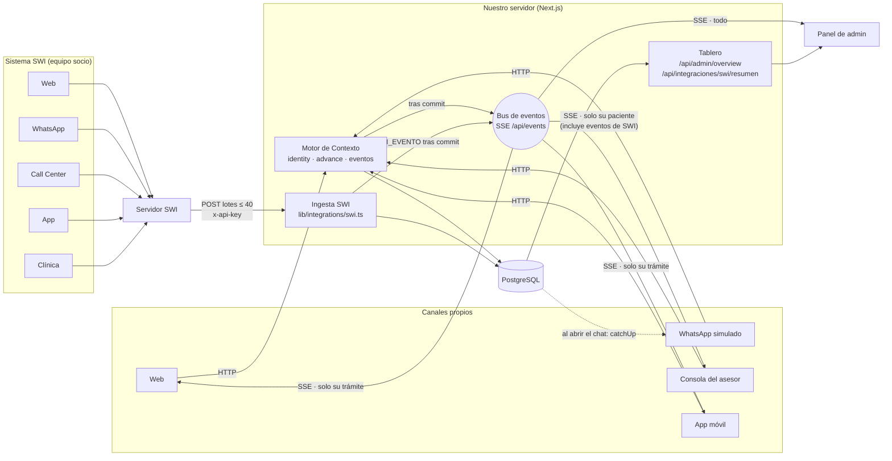
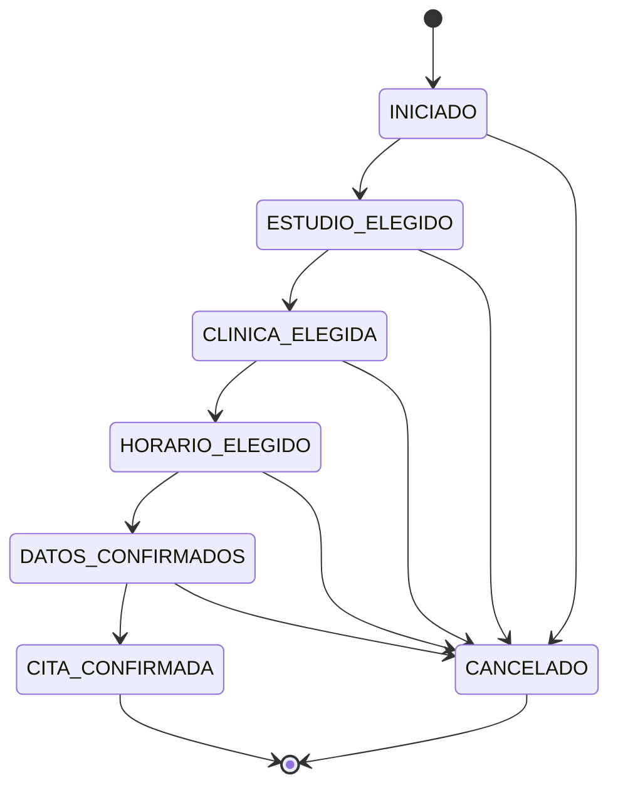
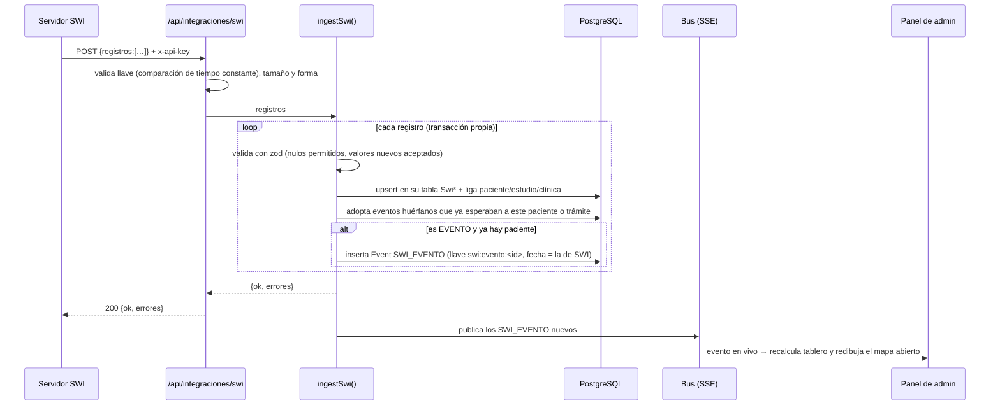
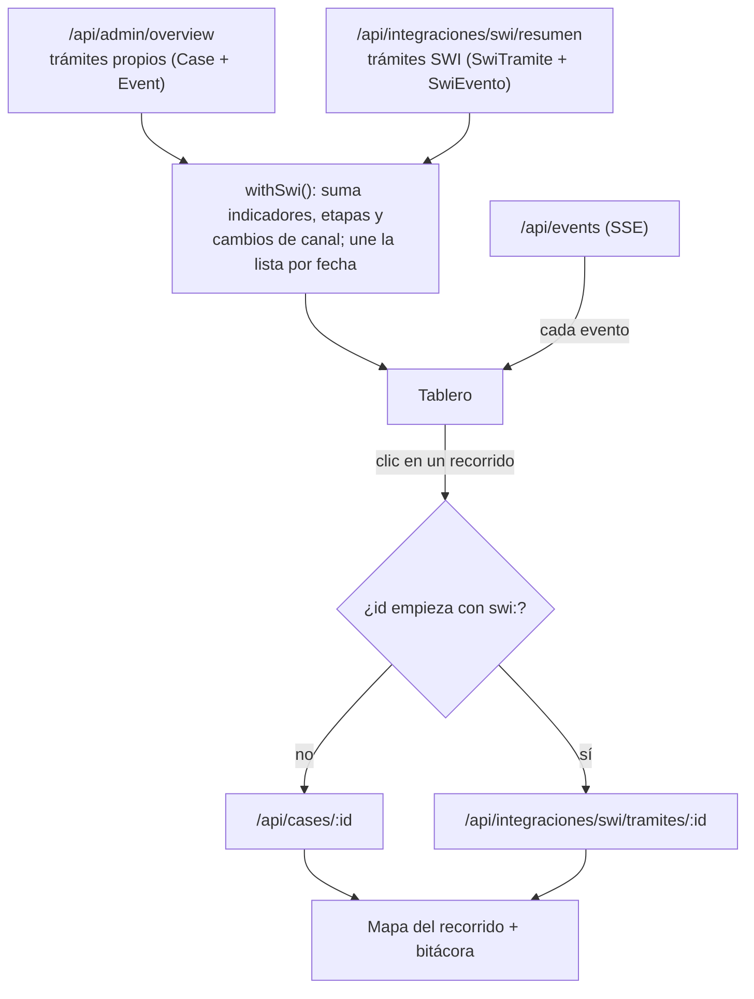
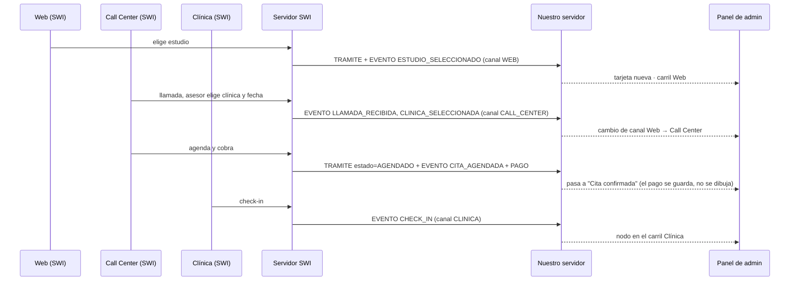

# Orquestación omnicanal: cómo funciona

Este documento explica cómo el sistema da seguimiento a un paciente en **cinco canales**: Web, WhatsApp, Call Center, App móvil y Clínica. También explica cómo el **panel de administración** controla todos esos canales desde un solo lugar.

**SWI ya integra los cinco canales.** El sistema del equipo socio cubre Web, WhatsApp, Call Center, App y Clínica, y nos manda todo lo que pasa en ellos. Nuestros canales propios siguen funcionando para la demo de continuidad (Web → WhatsApp simulado → Call Center → App). El panel de admin ve las dos fuentes juntas.

Hay dos fuentes de canales:

| Fuente | Qué canales trae | Cómo llega | Quién decide el estado |
|---|---|---|---|
| **Canales propios** (este prototipo) | Web, WhatsApp simulado, Call Center (consola del asesor), App | Llamadas HTTP al **Motor de Contexto** | Nuestro motor (`advance()`) |
| **SWI** (el sistema del equipo socio) | Web, WhatsApp, Call Center, App y **Clínica** | Lotes por `POST /api/integraciones/swi` | SWI. Nosotros guardamos y mostramos lo que manda |

**Principio:** cada trámite tiene **un solo dueño de su estado**. Los trámites propios los gobierna nuestro motor; los de SWI, SWI. El panel de admin **une las dos fuentes en una sola vista**, con los mismos indicadores, el mismo mapa del recorrido y el mismo tiempo real. Ninguna fuente escribe sobre los trámites de la otra.

---

## 1. Vista general

Quién recibe qué en tiempo real:

| Vista | Cómo se actualiza | Qué recibe |
|---|---|---|
| Panel de admin | SSE | Todos los eventos, de las dos fuentes |
| Consola del asesor | SSE filtrado por paciente | Los eventos del paciente que validó, **incluidos los de SWI** (se ligan por teléfono) |
| Web y App propias | SSE filtrado por trámite o paciente en sesión | Los cambios de su propio trámite |
| WhatsApp simulado | **Sin SSE.** Se pone al día al abrir el chat o volver a la pestaña (`catchUp`) | Avisos de cita confirmada o trámite cancelado en otros canales |

---

## 2. Canales propios: el Motor de Contexto

El estado de cada trámite propio vive en la tabla `Case`. Los canales no guardan estado: leen el caso, piden avanzar y escuchan eventos.

### Máquina de estados

- **`advance()`** (`lib/engine/case.ts`) es la **única** función que cambia un trámite. En una sola transacción valida la transición, actualiza `Case`, agrega el evento a la bitácora (`Event`) y, después del commit, lo publica en el bus.
- **Bloqueo optimista:** cada caso tiene `version`. Si dos canales editan a la vez, el segundo recibe 409 y se registra `CONFLICT_DETECTED`.
- **Idempotencia:** cada evento lleva un `idempotencyKey` único. Por ejemplo, `wa:in:<id>` para un mensaje de WhatsApp, así un reintento no avanza dos veces.
- **Pausado** no es un estado guardado. Se calcula: un trámite abierto sin actividad por 10 minutos (`PAUSE_AFTER_MS`) es candidato a recuperarse.

### Identidad: un paciente, muchos canales

La llave maestra es el **teléfono en formato E.164 verificado**. Cada canal tiene su propia identidad (`ChannelIdentity`), que se liga al paciente (`Patient`) al verificarse.

| Canal | Cómo se identifica | Verificación |
|---|---|---|
| Web | Teléfono primero (antes de elegir nada) | OTP por SMS (en la demo, el código se muestra en pantalla) |
| WhatsApp | El número del remitente | Fecha de nacimiento antes de mostrar datos |
| Call Center | El asesor busca por teléfono o nombre | 2 datos (fecha de nacimiento + últimos 4 del teléfono). Hasta entonces ve los datos enmascarados |
| App | Teléfono | OTP |

### Continuidad entre canales

Como el estado está en un solo lugar, cambiar de canal es leer el mismo `Case`:

- Si el paciente sigue en otro canal, se registra **`CASE_RESUMED`** (de → a) y el canal muestra el **siguiente paso pendiente**.
- **WhatsApp se pone al día** (`catchUp` en `lib/channels/whatsapp.ts`). Al abrir el chat, avisa lo que pasó en otros canales desde el último mensaje (cita confirmada o trámite cancelado) y ofrece el trámite pendiente actual. Un bloqueo por fila (`FOR UPDATE`) evita avisos duplicados.
- **La Web y la App** escuchan su trámite por SSE: si cambia en otro canal, se actualizan solas. La Web lo muestra como confirmado o cancelado y permite cancelarlo.
- WhatsApp no usa SSE: un chat solo recibe mensajes cuando el paciente escribe o abre la conversación, así que la puesta al día ocurre en ese momento.

---

## 3. Canales de SWI: la integración

SWI es la fuente de verdad de sus trámites. Nosotros **no** usamos nuestro OTP ni nuestro motor de casos para ellos. Guardamos sus registros tal como llegan, los ligamos al paciente por teléfono y los mostramos en el panel.

### Contrato

- **Ruta:** `POST /api/integraciones/swi`, con el encabezado `x-api-key` (la llave está en `.env` como `SWI_API_KEY`; nunca va al repositorio).
- **Cuerpo:** `{ "registros": [ … ] }`, de 1 a 40 registros por lote. Cada uno trae `tipo` e `id`.
- **Respuesta 200:** `{ "ok": [ids], "errores": [{ "id", "motivo" }] }`. Un registro con error no detiene a los demás.
- **Respuestas de error:**

  | Código | Cuándo |
  |---|---|
  | 401 | Falta la llave o no coincide |
  | 400 | El cuerpo no es un lote válido. Responde `{ "error": "motivo" }` |
  | 413 | El cuerpo pasa de 1 MB |

- **Upsert por `id`:** reenviar el mismo registro lo actualiza y nunca lo duplica, así SWI puede reintentar sin riesgo.
- **Cada cuánto llega (lo define SWI):** SWI empuja por HTTP cada 10 s lo nuevo o lo que cambió (hasta 10 lotes de 40 por vuelta). Espera hasta 20 s por lote. Reintenta los registros con error cada 5 min, y los 5xx o la falta de conexión en la siguiente vuelta. Entre SWI y nosotros **no hay SSE**: el SSE va de nuestro servidor a los navegadores (panel, consola del asesor, Web y App propias). Por eso un movimiento en SWI tarda hasta unos 10 s en verse en el panel.

### Tipos de registro y dónde se guardan

| Tipo | Tabla | Se liga a |
|---|---|---|
| `PACIENTE` | `SwiPaciente` | `Patient`, por teléfono |
| `TRAMITE` | `SwiTramite` | `Patient` + `Study` + `Clinic` (los busca o los crea) |
| `PAGO` | `SwiPago` | Al trámite, por `tramiteId` (sin llave foránea, para aceptar cualquier orden) |
| `EVENTO` | `SwiEvento` | Al paciente y al trámite. Además se **copia una vez a la bitácora** (`Event`, tipo `SWI_EVENTO`) |

Más detalles del contrato y de cada campo: [docs/integracion.md](integracion.md).

### Flujo de un lote

### Reglas que hacen robusta la ingesta

- **Cualquier orden.** Si un trámite llega antes que su paciente, se crea una paciente provisional "Sin nombre (SWI)", que se completa cuando llega el `PACIENTE`. Los eventos sin paciente conocido quedan **huérfanos** y se adoptan cuando llega su paciente o trámite.
- **Quién gana en los datos.** Si SWI creó a la paciente, sus datos mandan. Si la paciente ya existía en nuestro sistema, SWI solo **llena lo que falte** (bandera `creoPaciente`).
- **Valores desconocidos.** Un `tipoEvento`, `estado` o `canal` nuevo se guarda y no se rechaza.
- **Seguridad del pago.** Se rechaza cualquier número de tarjeta completo (prueba de Luhn). El esquema de `PAGO` es estricto.
- **Trámite eliminado.** Un evento `TRAMITE_ELIMINADO` marca `eliminadoEn` en el trámite indicado, en cualquier orden. El trámite deja de contarse en el tablero, pero su historial se conserva.
- **Familiares.** Un pariente llega como otro `PACIENTE`, cuyo `contactoTelefono` es el teléfono de quien agendó. El evento `CITA_PARA_FAMILIAR` aparece en la línea de tiempo de quien agendó, con el nombre y el parentesco.
- **Canal Clínica.** Nuestra bitácora no tiene ese canal, así que el evento se guarda con canal `SYSTEM` y el canal real va en `payload.canal`. El panel siempre usa `payload.canal`.

### Lo que llega hoy (25 nov 2026)

Eventos de SWI recibidos por canal:

| WhatsApp | Call Center | Web | Clínica | App | Total |
|---:|---:|---:|---:|---:|---:|
| 3,329 | 2,096 | 1,824 | 1,342 | 1,040 | 9,631 |

También: 1,148 pacientes, 1,174 trámites (5 eliminados) y 1,086 pagos. Llegan 27 tipos de evento distintos, desde `COTIZACION_INICIADA` hasta `RESULTADOS_ENTREGADOS`.

### Qué ve cada vista de los datos de SWI

| Vista | Qué ve de SWI |
|---|---|
| **Panel de admin** | Todo: trámites, recorridos, indicadores y eventos en vivo |
| **Consola del asesor** | Los eventos de SWI aparecen en la bitácora del paciente y llegan en vivo, porque se ligan por teléfono a la misma paciente |
| **Web, App y WhatsApp propios** | Nada de SWI. Solo muestran trámites propios, porque los de SWI tienen otro dueño |

**Lo que no cruza (todavía):**

- Los trámites de SWI no aparecen en la Web, App ni WhatsApp propios, y la puesta al día de WhatsApp no avisa de citas confirmadas en SWI.
- El resumen con IA del asesor solo usa los eventos propios; ignora los de SWI.
- Los pagos (`SwiPago`) se guardan, pero ningún panel los muestra todavía.
- 20 pacientes de SWI llegaron sin fecha de nacimiento. El asesor no puede validarlas con 2 datos hasta que SWI la mande.

---

## 4. El panel de admin: control y seguimiento

El admin (`/admin`, solo para el rol ADMIN) ve **todos** los trámites de las dos fuentes como si fueran uno solo.

El panel tiene dos vistas, en una barra lateral deslizable que se esconde al elegir una:

- **Dashboard** (vista inicial): indicadores (pacientes en flujo, confirmadas en 24 h contra ayer, trámites en riesgo, asesores activos), distribución por canal, embudo de conversión con el tiempo medio para confirmar, clínicas de mayor tráfico, monitoreo en vivo por etapa (estudio y clínica → horario y datos → pausados → confirmados), trámites por etapa, cambios de canal, actividad en vivo, personal activo, bot de WhatsApp e IA, auditoría y el estado de la integración con SWI. "Exportar corte" descarga un CSV con todos los recorridos. Las cifras extra salen de `GET /api/admin/stats` (`lib/admin-stats.ts`).
- **Pacientes Omnicanal** (`/admin#pacientes`): el mapa de cada recorrido, la lista filtrable y la nota de cada evento, descritos abajo. El indicador de riesgo y la campana abren esta vista filtrada en pausados, y la búsqueda de la barra superior también lleva aquí.

### De dónde salen los datos

- Las dos peticiones salen en paralelo. **Si SWI falla, el panel sigue funcionando** con los trámites propios.
- Los trámites de SWI se identifican por el prefijo `swi:` en su id y llevan una etiqueta **SWI** en la tarjeta y en la barra lateral.

### Cómo se traduce un trámite de SWI al tablero

| `estado` de SWI | Etapa en el panel | Estado del recorrido |
|---|---|---|
| `AGENDADO`, `CONFIRMADO` | Cita confirmada | Confirmado |
| `CANCELADO` | Cancelado | Cancelado |
| `ABANDONADO` | Según lo que ya eligió | Pausado |
| `DATOS_CAPTURADOS` | Datos confirmados | Activo o pausado |
| Otro o vacío | Horario, clínica o estudio, según lo que ya tenga | Pausado si lleva más de 10 minutos sin actividad |

### Qué muestra

| Elemento | Qué es | Cómo se calcula |
|---|---|---|
| **Indicadores** | Abiertos, pausados, confirmados en 24 h, cambios de canal en 24 h, recorridos multicanal y conflictos. Clic en "Pausados" filtra la lista | Suma de las dos fuentes |
| **Embudo por etapa** | Cuántos trámites hay en cada paso | Etapa propia, o traducida en el caso de SWI |
| **Cambios de canal** | Matriz de canal origen → canal destino | Dos eventos seguidos del mismo trámite en canales distintos |
| **Lista de recorridos** | Tarjetas filtrables por canal (incluye **Clínica**), por pausados o por búsqueda. Se muestran de 24 en 24 con "Mostrar más" | Todos los trámites de las dos fuentes, ordenados por última actividad |
| **Mapa del recorrido** | Un carril por canal (Web, WhatsApp, Call Center, App, Clínica) y un nodo por evento, en orden; tiene botón de reproducir | Bitácora del trámite |
| **Nota del evento** | Clic en un nodo del mapa: qué significa el evento, canal, fecha, quién lo hizo y sus datos (paso, estudio, folio, motivo, detalle de SWI). Se cierra con Esc o clic afuera | El evento de la bitácora |
| **Quién intervino** | Asesores y canales que tocaron el trámite | `actorId` de cada evento. En SWI aparece "Registrado por SWI" |
| **Feed en vivo** | Los últimos 60 eventos de todo el sistema | SSE |

En un trámite de SWI, el mapa muestra sus eventos y también los eventos del paciente que no traen trámite (llamadas, mensajes, correos). Estos se atribuyen al trámite que era el más reciente cuando ocurrieron.

### Tiempo real

1. Cualquier canal, propio o de SWI, genera un evento, y el bus lo publica **después** del commit.
2. El panel lo recibe por SSE (`/api/events?as=STAFF`).
3. Espera 400 ms para agrupar ráfagas, por ejemplo un lote de 40 de SWI. Después recarga los indicadores y, si el evento pertenece al recorrido abierto, redibuja el mapa.
4. Si se cae la conexión, el indicador cambia a "Reconectando…" y el navegador reconecta solo; al volver, manda `Last-Event-ID` y el servidor le reenvía lo que se perdió durante el corte.

---

## 5. Un recorrido de punta a punta

**Ejemplo de SWI.** La paciente cotiza en la Web de SWI, llama al Call Center, el asesor agenda y la paciente llega a la clínica.

En los canales propios el recorrido es el de [docs/secuencia.md](secuencia.md): Web → WhatsApp → Call Center → App, sin repetir datos.

---

## 6. Seguridad y privacidad

- **Roles.** Solo ADMIN ve el tablero y los trámites de SWI. El asesor solo escucha eventos de pacientes que validó. El paciente solo ve lo suyo.
- **Auditoría.** Abrir un expediente o un trámite de SWI genera `ADVISOR_OPENED_CASE`, que registra quién lo abrió y cuándo.
- **Llave de SWI.** Se compara en tiempo constante y vive solo en `.env`. Los errores se registran en el log solo con id y motivo, nunca con datos personales.
- **Pagos.** No se aceptan números de tarjeta. Solo marca, últimos 4 dígitos y referencia del procesador.
- **Reportes.** De `REPORTE_ENVIADO` se guardan los datos (folio, estudios, clínica), no la liga al PDF, que vive en el servidor de SWI.
- **IA.** Al modelo solo se manda el texto del mensaje y los tipos de evento; nunca nombre, teléfono ni CURP.

---

## 7. Operación

| Tarea | Cómo |
|---|---|
| Levantar para la red local (SWI envía a nuestra IP) | `npm run dev:lan` (`next dev -H 0.0.0.0 -p 3000`) |
| URL que configura SWI | `http://<IP-de-esta-Mac>:3000/api/integraciones/swi`. Si cambia la IP, hay que avisar a SWI |
| Exponer sin compartir red | Reenvío de puertos de VS Code (Dev Tunnels) en modo Public. Ojo: expone toda la app |
| Probar que responde | `curl -X POST <url> -d '{"registros":[]}'` sin llave debe dar 401 |
| Reiniciar la demo propia | `npx prisma migrate reset` (también borra las tablas de SWI, que hay que pedir que reenvíen) |

### Límites conocidos

- El panel recibe todos los trámites de SWI y los muestra de 24 en 24 (botón "Mostrar más"); con decenas de miles convendría paginar en el servidor.
- El tablero de SWI agrega en memoria (unas 10 mil filas). Con más volumen convendría pasarlo a agregados SQL.
- La relación familiar entre pacientes se muestra en el texto del evento; todavía no es un vínculo formal entre pacientes.
- La comunicación con SWI es HTTP sin cifrar dentro de la red local (aceptado para el prototipo). En producción debe ir por HTTPS.

---

## Archivos clave

| Archivo | Qué hace |
|---|---|
| `lib/engine/case.ts` | `advance()`: máquina de estados de los trámites propios |
| `lib/engine/identity.ts` | Identidad por canal, OTP y verificación |
| `lib/engine/events.ts` | Bitácora (`Event`) y bus de tiempo real |
| `lib/channels/whatsapp.ts` | Conversación de WhatsApp y puesta al día (`catchUp`) |
| `lib/integrations/swi.ts` | Validación e ingesta de los lotes de SWI |
| `lib/integrations/swi-overview.ts` | Traducción de los trámites de SWI al tablero y al mapa |
| `app/api/integraciones/swi/**` | Ruta de ingesta, resumen del tablero y detalle de un trámite |
| `app/admin/page.tsx` | Panel: une las dos fuentes y escucha en vivo |
| `app/admin/JourneyGraph.tsx` | Mapa del recorrido por carriles de canal y nota de cada evento |
| `app/_components/Timeline.tsx` | Bitácora compartida (admin y asesor); muestra el canal real de los eventos de SWI |
| `app/asesor/PatientPanel.tsx` | Consola del asesor: expediente y bitácora en vivo del paciente |
