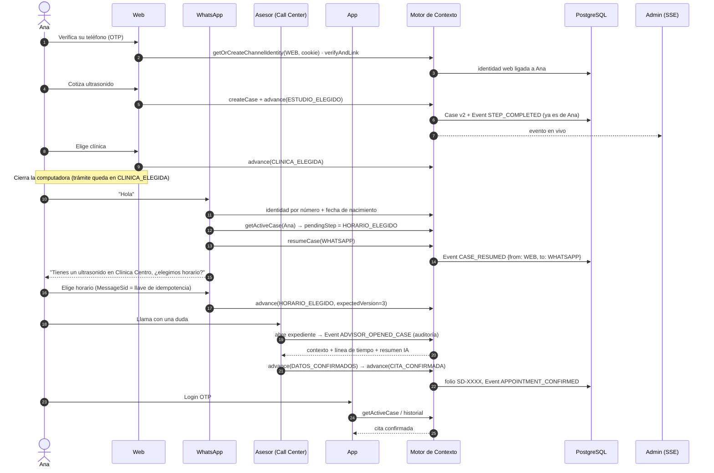

# Flujo de datos: el recorrido de Ana

## Validación en cada cambio de canal

1. **¿Quién es?** El canal resuelve `ChannelIdentity` → `Patient` (verificado o no).
2. **¿Qué tiene pendiente?** `getActiveCase` + `pendingStep`.
3. **¿Puede avanzar?** `advance` valida transición, datos (zod) y versión, todo en una transacción.
4. **¿Quién se entera?** Tras el commit, el bus publica y SSE entrega a asesor/admin/app.

## Resiliencia

| Situación | Qué pasa |
|---|---|
| Cierra la pestaña a mitad | Cada paso ya está guardado; otro canal lo retoma |
| Webhook duplicado | `idempotencyKey` → `duplicate: true`, no avanza |
| Dos canales a la vez | `version` → uno gana, el otro 409 + `CONFLICT_DETECTED` |
| Se cae la red del tablero | SSE reconecta y reenvía desde `Last-Event-ID` |
| Reinicio del servidor | El estado está en Postgres, no en memoria |
| LLM caído | Reglas por palabras clave + menú |
